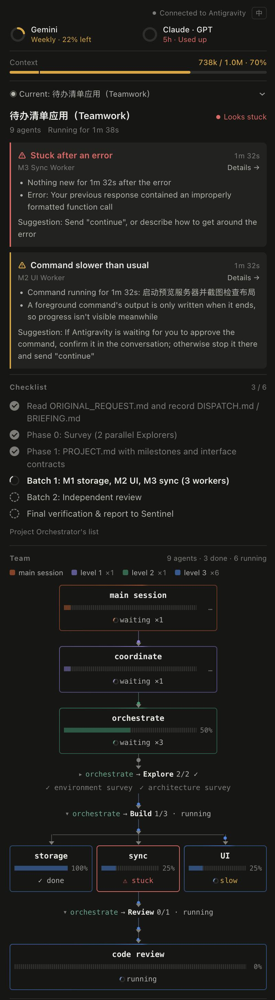

# Better View

English | [简体中文](README.zh-CN.md)

A sidebar for Google Antigravity showing what your agents are doing, their progress, and whether anything is stuck—with a full Teamwork run, quota, and context on one screen.

> Unofficial plugin, not affiliated with Google.



## Features

- **Checklist.** Live agent task list (done, in progress, not started). Ships `rules/AGENTS.md` so agents maintain `task.md` for multi-step requests; Teamwork runs show the orchestrator's `progress.md`.
- **Teamwork diagram.** Every agent on one screen—who dispatched whom, progress, and status. Finished groups collapse automatically; the shared model is shown once, and nodes only show a label when they use a different one. Click a node for its checklist, current step, and activity.
- **Stall detection.** Checks every conversation every 2 seconds, attaching evidence, a suggestion, and thresholds learned from your history:

  | Verdict | When |
  |---|---|
  | Needs you | Agent asked a question, or Antigravity awaits approval |
  | Slower than usual | Command or model call is much slower than your norm |
  | Looks stuck | Far slower than usual, or idle for 1 min after an error |
  | Stopped, unfinished | Antigravity went idle before the turn finished |
  | Service exited | Background service stopped while an agent was working |

  Manual stops and `/compact` do not trigger alerts. In team view, click an alert to jump to that agent.
- **macOS notifications.** Fires on *Needs you*, *Looks stuck*, *Stopped, unfinished*, and when a 3+ minute request finishes.
- **Quota.** One ring per model family (Gemini, Claude · GPT) showing the tightest window; hover for all windows and reset times.
- **Context.** Context window usage split by system prompt, tools, and messages.
- **Activity.** Steps across all agents, newest first; consecutive file reads fold into an expandable row.
- **Bilingual.** Follows Antigravity's language, with a top-right **中/EN** toggle.

> Skips redraws when idle and pauses updates while selecting text, so commands and errors are easy to copy.

## Requirements

- macOS (notifications use `osascript`)
- Antigravity 2.32 (tested on 2.32.2)
- Node.js 22+ (auto-detected via `PATH`, Homebrew, Volta, nvm; override with `BETTER_VIEW_NODE`)

## Install

```bash
git clone https://github.com/ytsu-ki/better-view.git
cd better-view && sh scripts/install-plugin.sh
```

Validates via `agy plugin validate --strict` (if found) and installs to `~/.gemini/config/plugins/better-view`. Restart Antigravity after installing or updating.

- **Open:** Side pane **+** menu (or **Overview ▸ Extensions**) → **Better View**. Stored per conversation, so open once in each new one.
- **Uninstall:** Remove `~/.gemini/config/plugins/better-view` and restart Antigravity.
- **Browser mode:** Run `npm start` to open the panel at http://127.0.0.1:47321/.

## Settings

Set via environment variables (under `env` in `mcp.json` and `sidecars/panel/sidecar.json` for the plugin):

| Variable | Effect |
|---|---|
| `BETTER_VIEW_NOTIFY` | `0` disables notifications |
| `BETTER_VIEW_LANG` | `zh` or `en` (overrides **中/EN** button) |
| `BETTER_VIEW_NODE` | Custom `node` path |
| `BETTER_VIEW_PORT` | `npm start` port (default `47321`) |
| `BETTER_VIEW_AG_DIR` | Antigravity data dir (default `~/.gemini/antigravity`) |

## Privacy & Data

Read-only toward Antigravity; nothing leaves your machine.

- **Reads:** `~/.gemini/antigravity/brain/` (transcripts, `task.md`), `annotations/` (titles), `conversations/<id>.db` (context breakdown, read-only), and Antigravity's local language server on `127.0.0.1` (status, quota, live context).
- **Writes:** `~/.cache/better-view/` (language, learned limits, notification process) and `~/Library/Logs/better-view/mcp.log` (start/stop and method names only, no content).
- **Listens:** `127.0.0.1` only.

Runs in the side pane as an MCP App, and includes a plugin sidecar for Antigravity's plugin UI (still behind a server-side switch for most accounts).

## Development

```bash
npm test
```

Simulate a Teamwork run (one stalled worker, one slow) at http://127.0.0.1:47403/:

```bash
node test/sim-team.mjs /tmp/bv-team-sim
```

> Deletes and recreates the target folder—use a temp path. Design notes (in Chinese): [DESIGN.md](DESIGN.md).

## License

[MIT](LICENSE)
