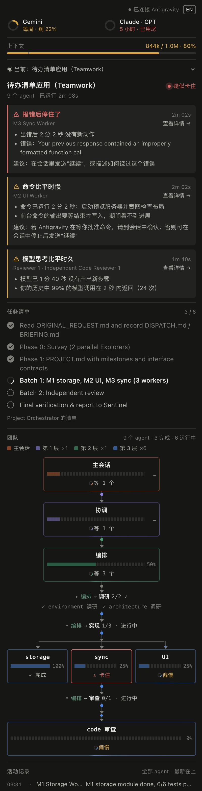

# Better View

[English](README.md) | 简体中文

Google Antigravity 侧边栏插件：一眼看清 Agent 在做什么、进度到哪、是否卡住，同屏总览 Teamwork 团队、剩余额度和上下文。

> 非官方插件，与 Google 无关。



## 功能

- **任务清单**：实时显示 Agent 清单（已完成 / 进行中 / 未开始）。内置 `rules/AGENTS.md`，让 Agent 在多步任务中维护 `task.md`；Teamwork 显示编排者的 `progress.md`。
- **Teamwork 团队图**：一屏看清派发关系、进度与状态。已完成的分组自动折叠；全队共享模型只写一次，不同模型的节点单独标出。点击方框查看该 Agent 的清单、当前步骤与活动记录。
- **卡死检测**：每 2 秒检查所有会话，附带依据、建议与按历史自动校准的阈值：

  | 状态 | 触发条件 |
  |---|---|
  | 等你操作 | Agent 提问，或 Antigravity 等待批准 |
  | 比平时慢 | 命令或模型调用明显慢于平时 |
  | 疑似卡住 | 耗时远超平时，或报错后 1 分钟无进展 |
  | 已停止 · 未完成 | Antigravity 已空闲，但当前轮次未结束 |
  | 服务已退出 | Agent 工作时后台服务已断开 |

  手动停止和 `/compact` 不触发告警。团队页点告警卡片可直达对应 Agent。
- **macOS 通知**：触发「等你操作」「疑似卡住」「已停止 · 未完成」，以及耗时 3 分钟以上的请求完成时提醒。
- **额度**：按模型系列显示圆环（Gemini、Claude · GPT），突出最紧周期；悬停查看各周期余量与重置时间。
- **上下文**：当前会话上下文占用，按系统提示、工具定义、对话消息分段。
- **活动记录**：所有 Agent 步骤倒序展示；连续读文件折叠为一行，点击展开。
- **中英双语**：跟随 Antigravity 语言，右上角 **中/EN** 可手动切换。

> 无变化时不重绘，选中文字时暂停刷新，方便直接复制命令和报错。

## 环境要求

- macOS（通知依赖 `osascript`）
- Antigravity 2.32（实测 2.32.2）
- Node.js 22+（自动查找 `PATH`、Homebrew、Volta、nvm；找不到时设 `BETTER_VIEW_NODE`）

## 安装

```bash
git clone https://github.com/ytsu-ki/better-view.git
cd better-view && sh scripts/install-plugin.sh
```

脚本会用 `agy plugin validate --strict` 校验（若存在 `agy`）并复制到 `~/.gemini/config/plugins/better-view`。安装或更新后需重启 Antigravity。

- **打开**：会话侧边栏 **+** 菜单（或 **Overview ▸ Extensions**）→ **Better View**。按会话记忆，新会话需首次打开一次。
- **卸载**：删除 `~/.gemini/config/plugins/better-view` 并重启 Antigravity。
- **浏览器模式**：运行 `npm start`，访问 http://127.0.0.1:47321/。

## 设置

通过环境变量配置（插件模式写在 `mcp.json` 和 `sidecars/panel/sidecar.json` 的 `env` 中）：

| 变量 | 说明 |
|---|---|
| `BETTER_VIEW_NOTIFY` | 设为 `0` 关闭通知 |
| `BETTER_VIEW_LANG` | `zh` 或 `en`（优先级高于 **中/EN** 按钮） |
| `BETTER_VIEW_NODE` | 指定 `node` 路径 |
| `BETTER_VIEW_PORT` | `npm start` 端口（默认 `47321`） |
| `BETTER_VIEW_AG_DIR` | Antigravity 数据目录（默认 `~/.gemini/antigravity`） |

## 读取与隐私

对 Antigravity 只读，数据不离开本机。

- **读取**：`~/.gemini/antigravity/brain/`（会话记录与 `task.md`）、`annotations/`（标题）、`conversations/<id>.db`（上下文构成，只读打开），以及 `127.0.0.1` 上的 Antigravity 本地语言服务（状态、额度、实时上下文）。
- **写入**：`~/.cache/better-view/`（语言偏好、校准阈值、通知进程标识）和 `~/Library/Logs/better-view/mcp.log`（仅记启停与方法名，不记内容）。
- **监听**：仅限 `127.0.0.1`。

以 MCP App 接入侧边面板，同时附带供 Antigravity 插件界面使用的 sidecar（目前对多数账号仍受服务端开关关闭）。

## 开发

```bash
npm test
```

在 http://127.0.0.1:47403/ 模拟一次 Teamwork 运行（一个 worker 报错卡住，一个偏慢）：

```bash
node test/sim-team.mjs /tmp/bv-team-sim
```

> 会删除并重建目标目录，请传入临时路径。中文设计文档见 [DESIGN.md](DESIGN.md)。

## 许可证

[MIT](LICENSE)
